# Smart ÖPNV – Bedienung der Tablet-App

Aufgenommen am 02.11.2026 auf dem verbundenen Tablet (W90), App **GPS Ansagen v9.0, Build 575**. Geladen war Linie **004**, Kurs **95**, Fahrt **06**, Zieltext **MG Hbf alle Halte**, Außenziel **RE4 M.Gladbach Hbf**. Die Schalter in den Einstellungen wurden nur gelesen und stehen so, wie sie vor der Aufnahme standen. Razzia wurde kurz eingeschaltet und sofort wieder ausgeschaltet. Es wurde kein Fahrschein gedruckt.

Nicht ausgelöst, weil diese Tasten sofort senden, anrufen, die Sitzung sperren oder die Zeitwirtschaft schreiben: Unfallruf, ZBL, die Pause-Taste im Menü, Abmelden, Arbeitsbeginn und Arbeitsende. App beenden wurde nur bis zur Rückfrage geöffnet und mit Abbrechen geschlossen.

## 1. Wofür die App da ist

Die App ist der Arbeitsplatz im Fahrzeug. Sie spielt Haltestellenansagen, zeigt den Fahrweg, schickt Texte an die Außenanzeige, nimmt Meldungen an die Leitstelle entgegen und kann Fahrscheine drucken. Routen, Ansagen, Zieltexte, Mitarbeiter, Tickets und datumgesteuerte Hinweise kommen aus dem Planer und landen über den Datenabgleich auf dem Gerät.

Voraussetzung für den Fahrbetrieb: ein angemeldeter Mitarbeiter, eine geladene Route mit Haltestellen, und für automatische Ansagen ein GPS-Empfang. Außenanzeige und IBIS brauchen zusätzlich den gewählten Anschluss (USB oder IP) und ein erreichbares Gerät.

## 2. ITCS, der Fahrbildschirm

ITCS ist der Bildschirm während der Fahrt. Die gelbe Markierung an der unteren Leiste zeigt, welcher Bereich offen ist.

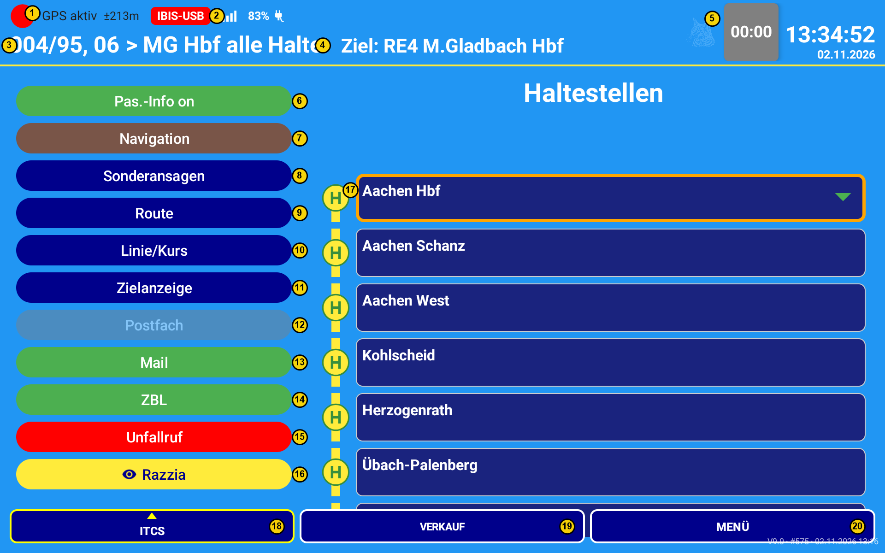

| Nr. | Anzeige oder Taste | Wofür | Bedingung |
| --- | --- | --- | --- |
| 1 | GPS aktiv und Meterangabe | Das Gerät hat eine Position. Die Meterzahl ist die gemeldete Genauigkeit. | Ohne Fix steht hier GPS inaktiv. Das ist der Empfang, nicht die Fahrgastansage. |
| 2 | IBIS-USB | Gewählter Weg zur Anzeige. Auf diesem Gerät stand USB. | Die Taste öffnet die Anschlussinfo. Im Menü stand gleichzeitig „Keine USB-Geräte gefunden“: der Modus ist USB, ein Wandler war in dem Moment nicht aufgezählt. |
| 3 | 004/95, 06 | Linie, Kurs und Fahrt der offenen Route. | Tippen öffnet die Kurzwahl nur, wenn die Route das vorsieht. |
| 4 | Ziel | Text, der als Fahrtziel geführt wird. | Wechselt mit der Route oder mit einer Zielanzeige. |
| 5 | 00:00, Uhr, Datum | Laufzeitfeld und Gerätezeit. | 00:00 ist die angezeigte Betriebsdauer, solange keine Fahrtzeit läuft. |
| 6 | Pas.-Info | Schaltet die automatische Haltestellenansage. | Die Beschriftung nennt die nächste Aktion. „Pas.-Info on“ heißt: die Ansage ist aus und wird mit dem Tipp eingeschaltet. „Pas.-Info off“ schaltet sie wieder aus. Dafür müssen Route und GPS stehen. |
| 7 | Navigation | Karte des hinterlegten Fahrwegs. | Die Route braucht einen Fahrweg mit mindestens zwei Punkten. Sonst erscheint nur der Hinweis, zuerst einen Fahrweg anzulegen. |
| 8 | Sonderansagen | Liste der zusätzlichen Ansagen. | Ein Tipp auf eine Zeile spielt sie sofort im gewählten Ausgang ab. |
| 9 | Route | Öffnet die Routenwahl. | Die bisherige Route bleibt, bis eine neue Zeile gewählt wird. Abbrechen lässt alles stehen. |
| 10 | Linie/Kurs | Ziffernfeld für Linie und Kurs. | Wirkt erst mit OK. Abbrechen verwirft die Eingabe. |
| 11 | Zielanzeige | Texte für die Außenanzeige. | Eine Zeile geht an die Anzeige. Schließen sendet nichts. |
| 12 | Postfach | Nachrichten der Leitstelle (ZBL). | Nur bedienbar, wenn mindestens eine Nachricht da ist. Sonst grau, so wie auf dem Bild. |
| 13 | Mail | Fertige Meldungstexte an die Leitstelle. | Ein Tipp auf eine Vorlage sendet sofort. Dafür muss auf dem Gerät eine Absender-Telefonnummer hinterlegt sein. |
| 14 | ZBL | Verbindung zur Leitstelle. | Je nach Einstellung entweder Anruf oder eine Sprechwunsch-Meldung. Beides geht sofort raus. |
| 15 | Unfallruf | Sofortmeldung an das Haupthandy. | Sendet ohne zweite Taste eine soschat-Datei. Nur im Ernstfall. |
| 16 | Razzia | Schaltet die Entwerter-Razzia. | Die Taste gibt es nur, wenn sie in den Anzeigen-Einstellungen für den Entwerter eingeschaltet ist. Gelb mit Auge: aus. „Razzia AN“: an. Ein zweiter Tipp schaltet zurück. |
| 17 | Haltestellen | Ablauf der offenen Route. | Die orange umrandete Zeile ist die aktuelle Haltestelle. Die Liste läuft mit der Fahrt weiter, sobald Pas.-Info läuft. |
| 18 | ITCS | Zurück auf diesen Fahrbildschirm. | Immer erreichbar. |
| 19 | VERKAUF | Fahrscheinverkauf. | Steht hier, weil in den Einstellungen „Verkauf aktiv“ an ist. Sonst heißt die Mitte BEARBEITEN und ist auf einem Mitarbeitergerät gesperrt. Verkauf braucht eine echte Linie/Kurs bzw. Route, nicht 000/00, und eine offene Verkaufsperiode. |
| 20 | MENÜ | Hauptmenü. | Immer erreichbar. |

Unten rechts steht die Fassung, hier `V9.0 · #575 · 02.11.2026 13:16`.

Im Menü kann dieselbe GPS-Zeile „GPS inaktiv“ zeigen, während das ITCS „GPS aktiv“ zeigt. Das sind zwei Angaben: das ITCS meldet den Positionsempfang, das Menü meldet, ob die Fahrgastansage (Pas.-Info) läuft. Auf dem Gerät war der Empfang da und die Ansage aus.

## 3. Sonderansagen

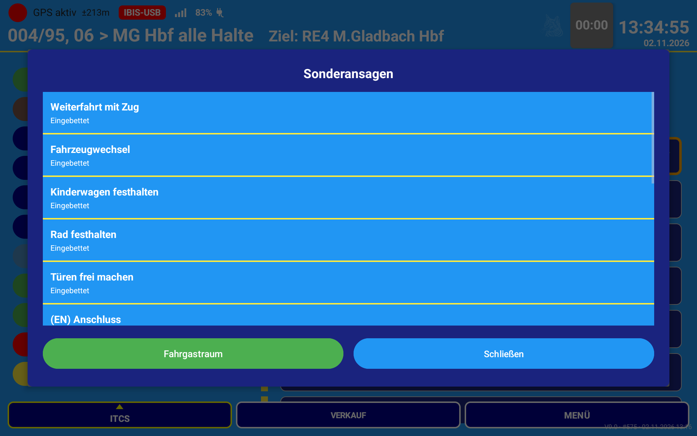

Die Liste kommt aus den eingespielten Ansagen. „Eingebettet“ bedeutet: die Tondatei liegt in der App, nicht nur als Verweis. Auf dem Gerät standen unter anderem Weiterfahrt mit Zug, Fahrzeugwechsel, Kinderwagen festhalten, Rad festhalten, Türen frei machen und (EN) Anschluss.

- Tipp auf eine Zeile: die Ansage läuft sofort.
- **Fahrgastraum**: Ziel des Tons und gleichzeitig die Sprechtaste. Gedrückt halten spricht das Mikrofon in den Fahrgastraum.
- Langer Druck auf eine Zeile, wenn Zonen an sind: der Ausgang wechselt, zum Beispiel Fahrgastraum, außen oder beides.
- **Schließen** beendet die Liste, ohne eine weitere Ansage zu starten.

## 4. Route wählen

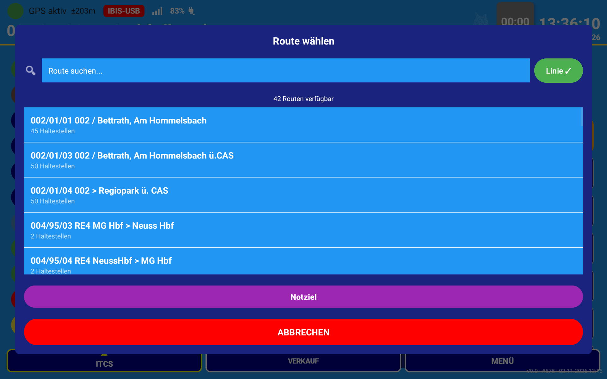

Oben kann nach Name oder Nummer gesucht werden. „Linie“ filtert auf die aktuelle Linie. Die Zahl daneben ist die Menge der passenden Routen, hier 42. Jede Zeile zeigt Linie, Variante, Ziel und die Anzahl der Haltestellen.

**Notziel** setzt ein Notziel, ohne die Haltestellenliste umzubauen. **ABBRECHEN** schließt die Liste und lässt die offene Route stehen. Eine angetippte Zeile übernimmt diese Route.

## 5. Linie und Kurs

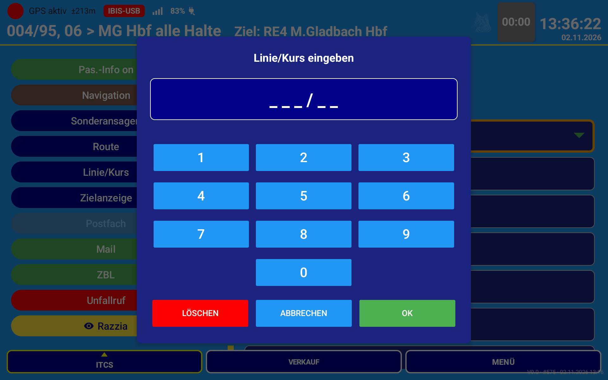

Das Feld ist `Linie / Kurs`, auf dem Gerät als `_ _ _ / _ _`. Ziffern füllen es von links. **LÖSCHEN** nimmt die letzte Stelle zurück. **OK** übernimmt. **ABBRECHEN** verwirft die Eingabe. Die offene Fahrt 004/95 blieb unverändert, weil OK nicht gedrückt wurde.

## 6. Zielanzeige

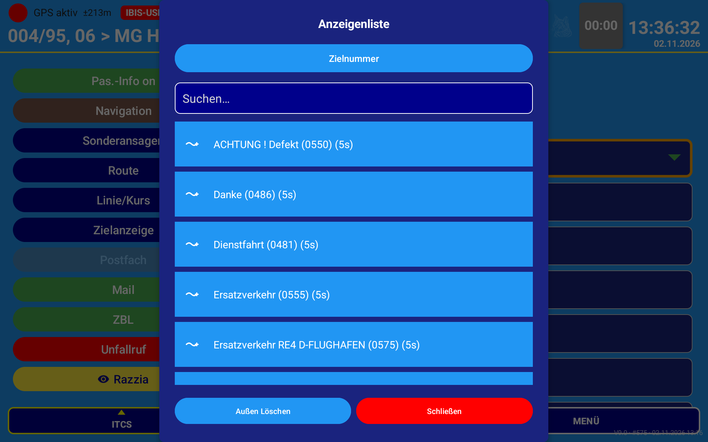

Die Liste ist die Zielliste aus dem Planer. Hinter dem Text stehen Zielnummer und Anzeigedauer, zum Beispiel „Danke (0486) (5s)“. Ein Tipp auf eine Zeile schickt diesen Text an die Außenanzeige.

- **Zielnummer** öffnet ein Ziffernfeld für eine Nummer, die nicht in der Liste steht.
- **Suchen** filtert die Liste.
- **Außen Löschen** leert die Außenanzeige.
- **Schließen** sendet nichts.

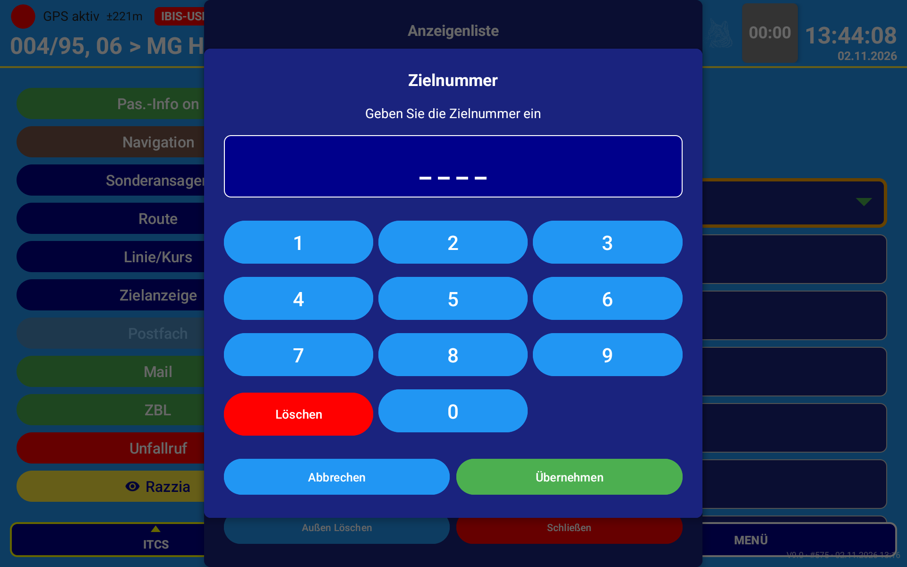

Die Zielnummer hat vier Stellen. **Löschen** radiert, **Abbrechen** verwirft, **Übernehmen** schickt die Nummer an die Anzeige. Hier wurde abgebrochen.

## 7. Postfach, Mail, ZBL, Unfallruf

**Postfach** war grau. Es wird blau und tippbar, sobald eine Leitstellen-Nachricht (ZBL) auf dem Gerät liegt. Dann öffnet sich die Nachrichtenliste.

**Mail** zeigt die Vorlagen. Ein Tipp auf eine Zeile sendet den Text sofort an die Leitstelle, sofern eine Absender-Telefonnummer auf dem Gerät liegt. Ohne Nummer kommt nur der Hinweis, dass keine mailchat-Datei erzeugt werden kann.

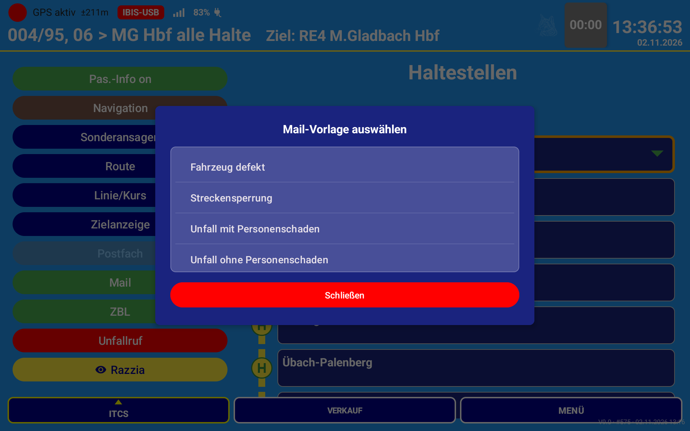

Auf dem Gerät: Fahrzeug defekt, Streckensperrung, Unfall mit Personenschaden, Unfall ohne Personenschaden. **Schließen** sendet nichts. Es wurde keine Vorlage abgeschickt.

**ZBL** spielt den Funkton und macht danach eines von beiden, je nach Einstellung am Gerät: einen Anruf zur hinterlegten Leitstellennummer oder eine Sprechwunsch-Meldung. Beides ist sofort. Deshalb wurde die Taste für die Aufnahmen nicht benutzt.

**Unfallruf** baut sofort eine soschat-Meldung an das Haupthandy und sendet sie. Es gibt keine Abbrechen-Taste. Die Taste ist der Ernstfall, nicht ein Formular.

## 8. Navigation

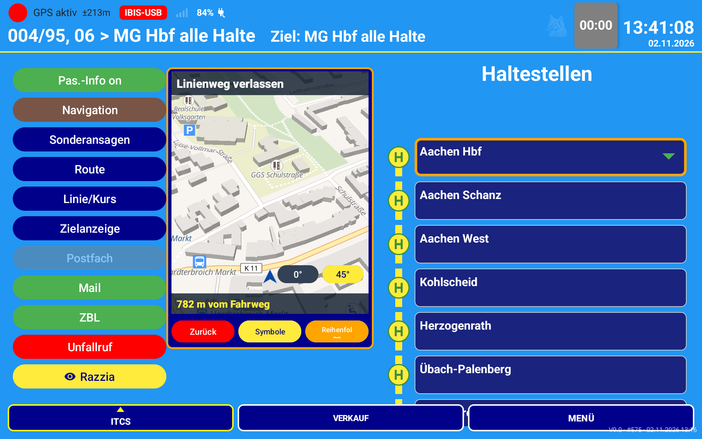

Die Karte zeigt den hinterlegten Linienweg. Auf dem Bild lag der Empfang **782 m vom Fahrweg**, deshalb die Überschrift „Linienweg verlassen“. Der blaue Pfeil ist die Geräteposition, die gelben Felder zeigen Kurs und einen zweiten Winkel.

- **Zurück** schließt die Karte und lässt Route und Ansage unverändert.
- **Symbole** schaltet die Kartensymbole.
- **Reihenfolge** betrifft die Haltestellenfolge auf dem Fahrweg.

Bedingung: zur offenen Route muss ein Fahrweg gespeichert sein. Fehlt er, bleibt es bei dem Hinweis, zuerst einen Fahrweg zu erstellen. Die Karte ersetzt die Ansage nicht. Pas.-Info bleibt ein eigener Schalter.

## 9. Razzia

Die gelbe Taste mit dem Auge schaltet die Entwerter-Razzia. Sie erscheint nur, wenn der Razzia-Schalter im Entwerter-Bereich der Anzeigen an ist. Ein Tipp macht daraus „Razzia AN“, der nächste Tipp stellt „Razzia“ wieder her. Nach der Aufnahme steht die Taste wieder auf aus.

## 10. Verkauf

Die untere Mitte heißt **VERKAUF**, weil in den Einstellungen „Verkauf aktiv“ eingeschaltet ist. Damit ersetzt Verkauf auf dem Tablet die Taste BEARBEITEN. Die Produkte kommen aus dem Ticketing des Planers.

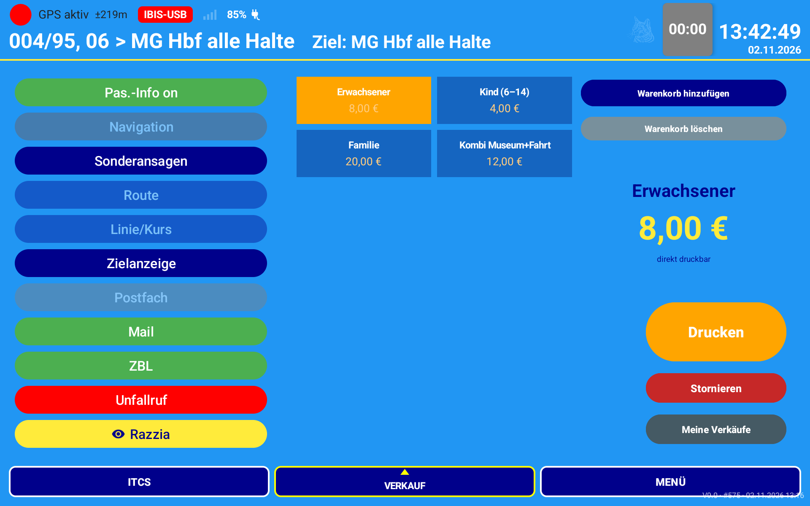

Auf dem Gerät lagen vier Produkte: Erwachsener 8,00 €, Kind (6–14) 4,00 €, Familie 20,00 €, Kombi Museum+Fahrt 12,00 €. Das orange Feld ist die gewählte Karte, rechts daneben Preis und der Hinweis „direkt druckbar“.

- **Warenkorb hinzufügen** legt die gewählte Karte in den Korb. Solange der Korb leer ist, bleibt **Warenkorb löschen** grau.
- **Drucken** druckt die gewählte Karte. Das wurde nicht gedrückt.
- **Stornieren** storniert einen gedruckten Verkauf.
- **Meine Verkäufe** öffnet die Verkaufsliste dieser Sitzung.

Verkauf öffnet nur mit einer nutzbaren Linie oder Route. Linie/Kurs 000/00 reicht nicht. Ist die Verkaufsperiode zu, bleibt die Taste gesperrt und es erscheint der Hinweis zur Sperre. BEARBEITEN, falls Verkauf aus ist, geht auf einem reinen Mitarbeitergerät nicht. Dafür ist das Hauptgerät zuständig.

## 11. Hauptmenü

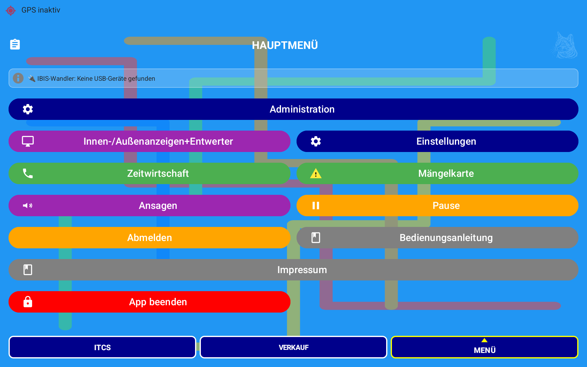

Oben steht der Zustand der Fahrgastansage. Hier „GPS inaktiv“, weil Pas.-Info aus war. Darunter der IBIS-Status, hier „IBIS-Wandler: Keine USB-Geräte gefunden“.

| Taste | Wofür | Bedingung |
| --- | --- | --- |
| Administration | Geräteverwaltung, siehe unten. | Auf diesem Tablet in der ersten Zeile. |
| Innen-/Außenanzeigen+Entwerter | Protokolle, Tests, Zielliste, SEV-TFT, Entwerter. | Kann eine Bereichssperre mit Kennwort davor setzen. Auf diesem Gerät öffnete sie sich direkt. |
| Einstellungen | Schalter des Geräts. | Siehe Abschnitt 13. Die Testfahrt-Freigabe wurde nur zum Prüfen an- und sofort wieder ausgeschaltet. |
| Zeitwirtschaft | Kommen, Gehen, Pause, Korrektur. | Schreibt Arbeitszeit. Arbeitsbeginn und Arbeitsende wurden nicht gedrückt. |
| Mängelkarte | Mängel am Fahrzeug. | Speichern legt einen Mangel an. Es wurde nichts gespeichert. |
| Ansagen | Tondateien einspielen und ansehen. | Unterpunkte siehe unten. |
| Pause | Sperrt die App und schreibt eine Pause. | Nur mit dem Anmeldekennwort des Fahrers wieder auf. Deshalb nicht ausgelöst. |
| Abmelden | Beendet die Fahrer-Sitzung sofort und öffnet die Anmeldung. | Arbeitsende, Verkauf und GPS-Nachsendung laufen danach im Hintergrund. Nicht ausgelöst, die Sitzung blieb angemeldet. |
| Bedienungsanleitung | Kurzanleitung in der App. | Lesen, Schließen kommt über Zurück. |
| Impressum | Hersteller und Fassung. | Nur Anzeige. |
| App beenden | Fragt nach und schließt danach die App. Alle laufenden Dienste stoppen. | Dialog geöffnet und mit Abbrechen geschlossen. Die App läuft weiter. |

Datentransfer und Protokoll liegen auf diesem Tablet unter Administration, nicht in der ersten Menüfläche. Richtungserkennung liegt zusätzlich in den Einstellungen.

## 12. Administration

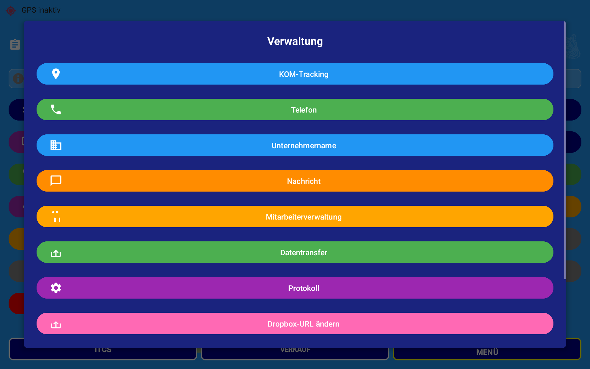

- **KOM-Tracking**: Ortung, Karte, Fernziel, Fernupdate, Fernroute, Fahrgastraum-Durchsage und die Fahrzeugliste. Das Hauptgerät empfängt die Standorte, ein Fahrzeug sendet den eigenen.
- **Telefon**: Gerät registrieren, Handynummer der ZBL und die Nummer des Hauptgeräts. Zurück speichert nichts, solange die Felder nicht geändert und bestätigt werden.
- **Unternehmername**: Name auf Belegen und Meldungen. Abbrechen lässt den bisherigen Namen stehen.
- **Nachricht**: Text an ein Fahrzeug oder an alle. Eine Zeile antippen wählt den Empfänger. Senden geht erst über die Sendetaste. Die wurde nicht gedrückt.
- **Mitarbeiterverwaltung**: Personen auf dem Gerät, mit Telefonnummer. Hinzufügen, und per langem Druck Bearbeiten oder Löschen. Der Planer liefert die Liste. Eine leere Lieferung darf die vorhandene Liste nicht löschen. Es wurde niemand geändert.
- **Datentransfer**: Daten importieren, Daten exportieren, eine Route, mehrere Routen, Route importieren, Route an alle Fahrzeuge senden. Jeder Punkt startet erst nach der nächsten Bestätigung. Es wurde nichts übertragen.
- **Protokoll**: Fehlerprotokoll hinter einem Kennwort mit Ziffernfeld. Ohne das Kennwort bleibt das Protokoll zu.
- **Dropbox-URL ändern**: Verbindung zum Datenkonto. „Mit Dropbox verbinden“ meldet das Konto an. Die Verbindung wurde nicht gelöscht und nicht neu angelegt.
- **ZBL-Button (Tablet)**: legt fest, ob die grüne ZBL-Taste anruft oder einen Sprechwunsch sendet. Die Auswahl wurde nicht umgestellt.

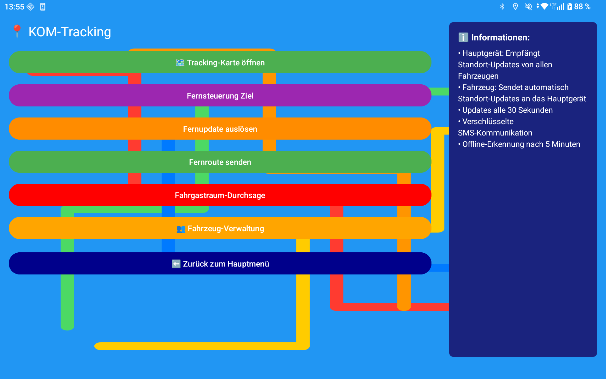

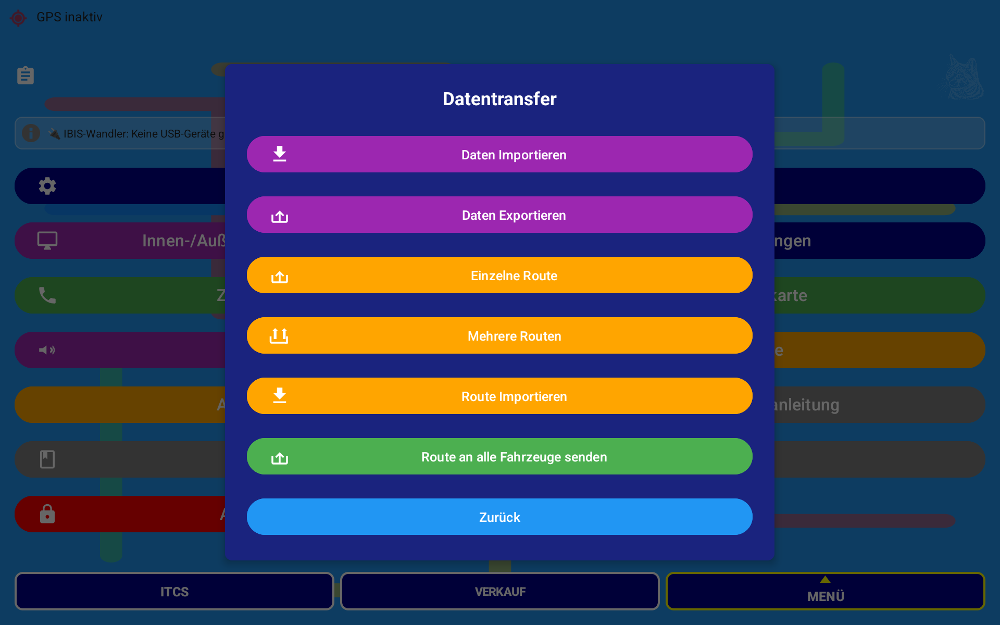

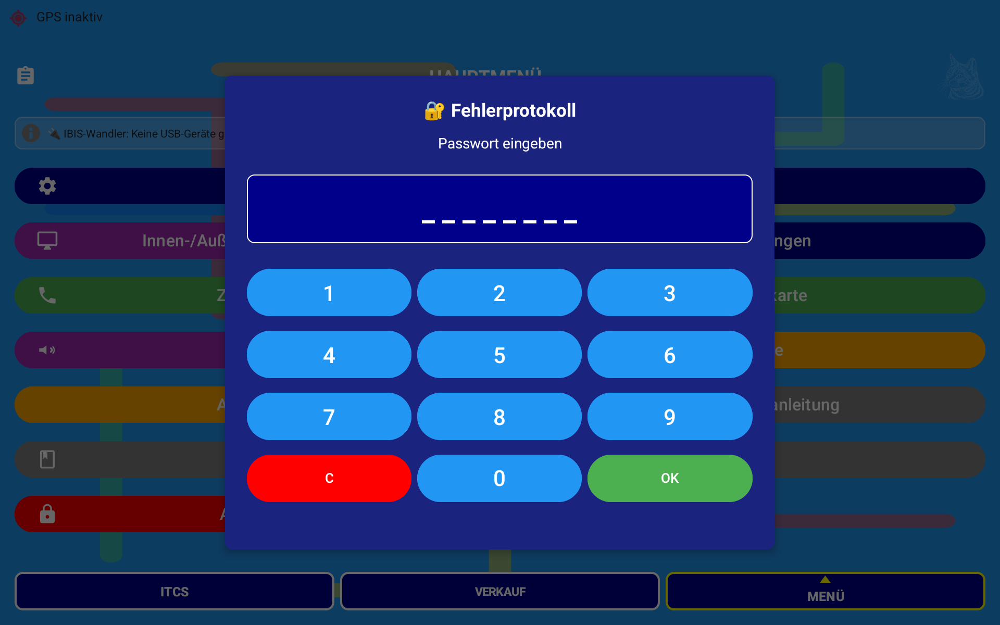

## 13. Einstellungen

Die Schalter wurden gelesen und nicht verändert. So standen sie auf dem Gerät:

| Schalter | Stand | Wirkung |
| --- | --- | --- |
| Tastentöne aktivieren | an | Kurzer Ton bei Tastendruck. |
| Bluetooth-Zwangskopplung | an | Hält Bluetooth für die Fahrgastraum-Ansagen an, auch wenn es ausgeschaltet wurde. |
| Hauptgerät-Modus | an | Dieses Gerät darf bearbeiten und den vollen Datenabgleich fahren. Ein Mitarbeitergerät sieht weniger. |
| Automatische Routen-Öffnung | an | Öffnet die zur Fahrt passende Route von selbst. |
| Nachtmodus | aus | Dunkle Darstellung. |
| Verkauf aktiv | an | Untere Mitte wird VERKAUF. Produkte kommen aus dem Planer. |
| Status- und Navigationsleiste ausblenden | an | Blendet Akkuzeile und die Android-Leiste aus. Wischen vom Rand holt sie kurz zurück. |
| Automatisch bei GPS-Betrieb | an | Die Leisten bleiben während des GPS-Betriebs weg. |

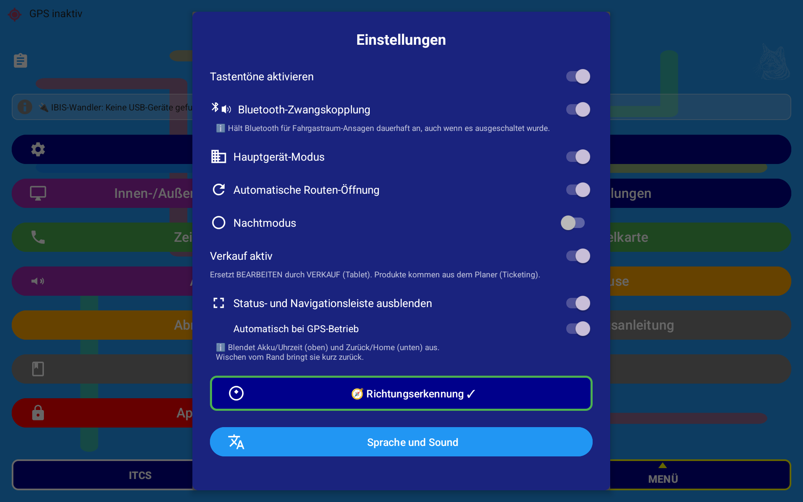

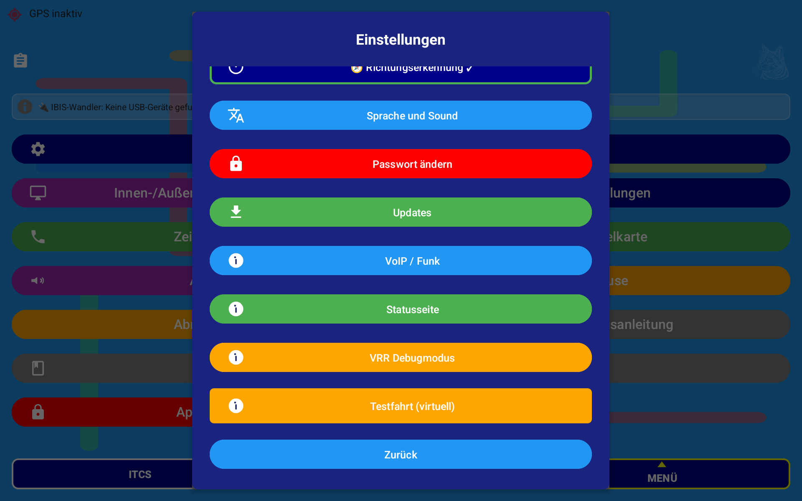

Darunter, ohne dass etwas gespeichert wurde:

- **Richtungserkennung**: Haken zeigt, dass sie an ist. Damit spielt die App eine Haltestelle nur, wenn der Wagen sich auf sie zubewegt. Der Dialog zeigt den Status und erklärt die Funktion. Deaktivieren wurde nicht gedrückt, der Haken bleibt.
- **Sprache und Sound**: Deutsch, Niederländisch oder Englisch. Dazu die Stimmenverstärkung im Fahrgastraum und die Stereo-Zonen: links innen, rechts außen. Haltestellen gehen nach innen. Bei Sonderansagen wechselt ein langer Druck innen, außen oder beides. Die Sprache wurde nicht umgestellt.
- **Passwort ändern**: zwei getrennte Punkte, das Pause-Kennwort und das Admin-Kennwort. Abbrechen lässt beide stehen.
- **Updates**: lädt sofort eine neue App-Fassung aus Dropbox und startet die Installation. Deshalb nicht angetippt.
- **VoIP / Funk**: Gegensprechen mit der Leitstelle. Zeigt, ob die Verbindung bereit ist, die Gegenstelle und den Gerätenamen. Getrennt vom ZBL-Anruf.
- **Statusseite**: GPS, Anzeige, IBIS-Wandler und Dropbox, jeweils mit kurzem Zustand.
- **VRR Debugmodus**: Abfrage von Abfahrten über Haltestellen-ID, Linie und Fahrt. Für den Fahrbetrieb nicht nötig. Es wurde keine Abfrage abgeschickt.
- **Testfahrt (virtuell)**: ein Tipp schaltet nur die Freigabe. Mit Haken öffnet MENÜ während Pas.-Info die Simulation, ohne Haken bleibt MENÜ dabei gesperrt. Die Simulation selbst fährt die Route auf der Karte ohne echtes GPS. Der Haken wurde für die Aufnahme kurz gesetzt und sofort wieder gelöscht. Es läuft keine Testfahrt.
- **Zurück** schließt die Einstellungen.

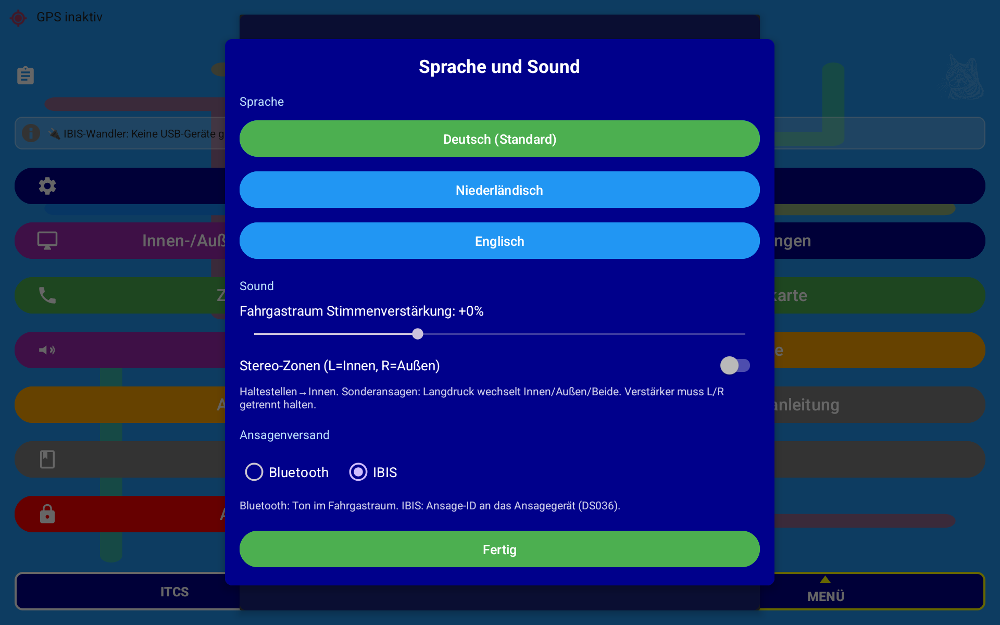

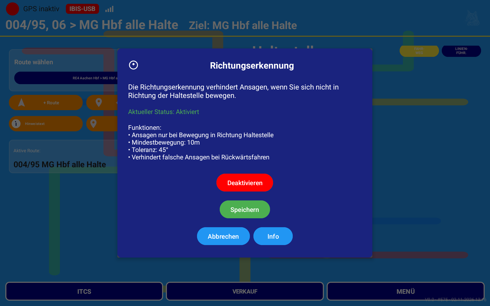

## 14. Anzeigen und Entwerter

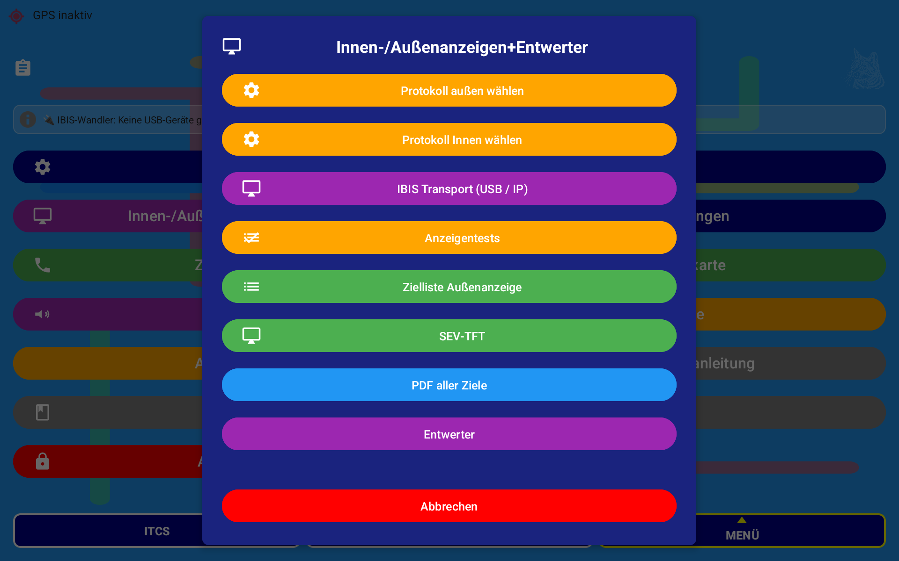

- **Protokoll außen wählen**: DS003, DS003a, DS021, DS021T und weitere. Grün ist das aktive Protokoll. Ein Tipp auf eine andere Zeile stellt um. Es wurde keine Zeile gewählt, das bisherige Protokoll bleibt.
- **Protokoll Innen wählen**: Innenprotokoll, dazu TFT-Zeit und optional DS009 zusätzlich. Grün ist aktiv. Es wurde nichts umgestellt.
- **IBIS Transport (USB / IP)**: je Kanal USB oder IP. IP schickt das Rohprotokoll an eine Serial-over-IP-Brücke. Mobitec bleibt USB-RS485. Auf dem Gerät standen Außen und Innen auf USB, der TFT-Server war aus. Es wurde nichts gespeichert.
- **Anzeigentests**: Menü der Prüfsendungen (Haltestelle, außen je Protokoll, Liniennummer). Eine Zeile sendet sofort an die Anzeige. Es wurde keine Prüfung gesendet.
- **Zielliste Außenanzeige**: gespeicherte Zieltexte mit Protokoll. Eine Zeile kann gesendet oder gelöscht werden. Es wurde nichts gelöscht und nichts gesendet.
- **SEV-TFT**: Schienenersatzverkehr auf einem separaten Display. Linie und Ziel kommen aus dem Routennamen, die Haltestellen aus dem Verlauf. Adresse, Port und Schlüssel müssen stimmen, wenn SEV an ist. Speichern, Test und Senden wurden nicht gedrückt.
- **PDF aller Ziele**: schreibt sofort eine PDF-Datei aller Zieltexte. Nicht ausgeführt.
- **Entwerter**: Razzia aus oder an, die ITCS-Taste „Razziabutton“, und Testfelder für DS004 und DS004a. Die Razzia blieb aus, der Knopf im ITCS bleibt vorhanden. Es wurde kein Entwertertest gesendet.
- **Abbrechen** schließt den Bereich.

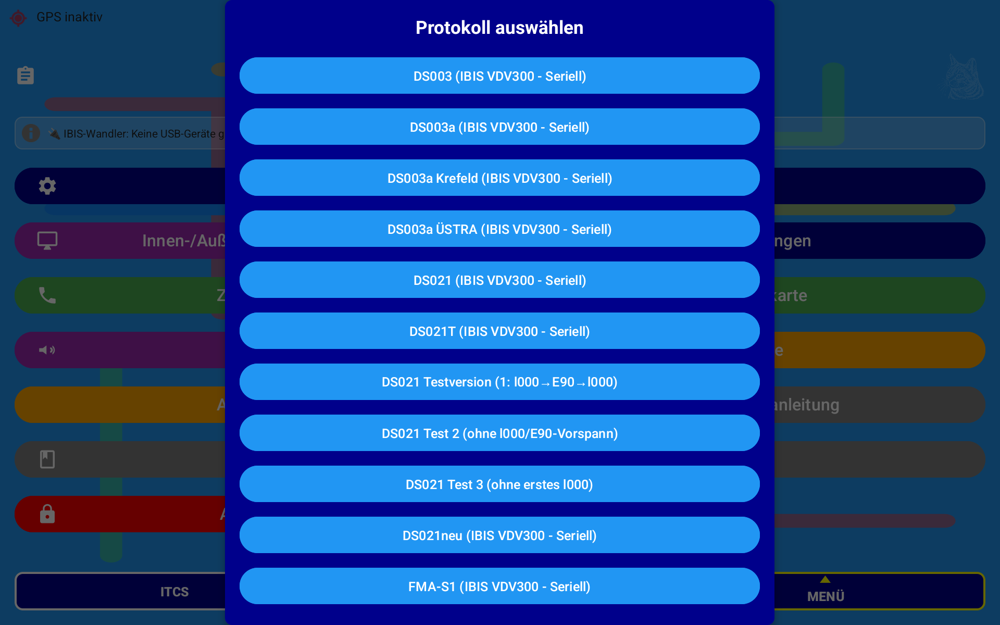

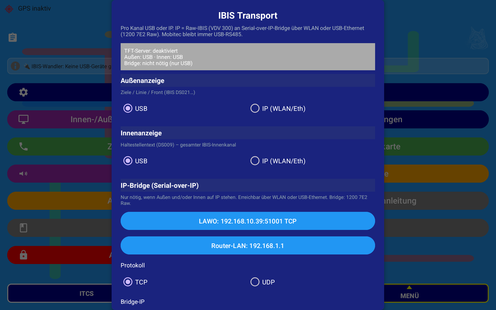

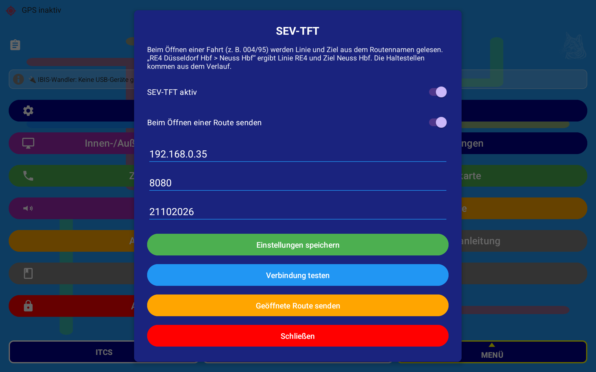

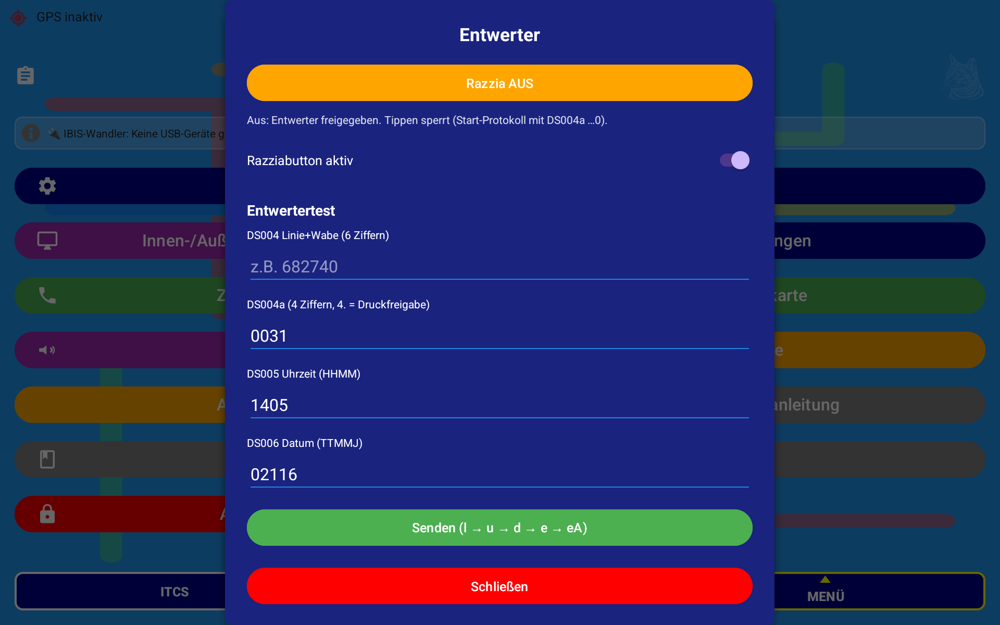

## 15. Zeitwirtschaft

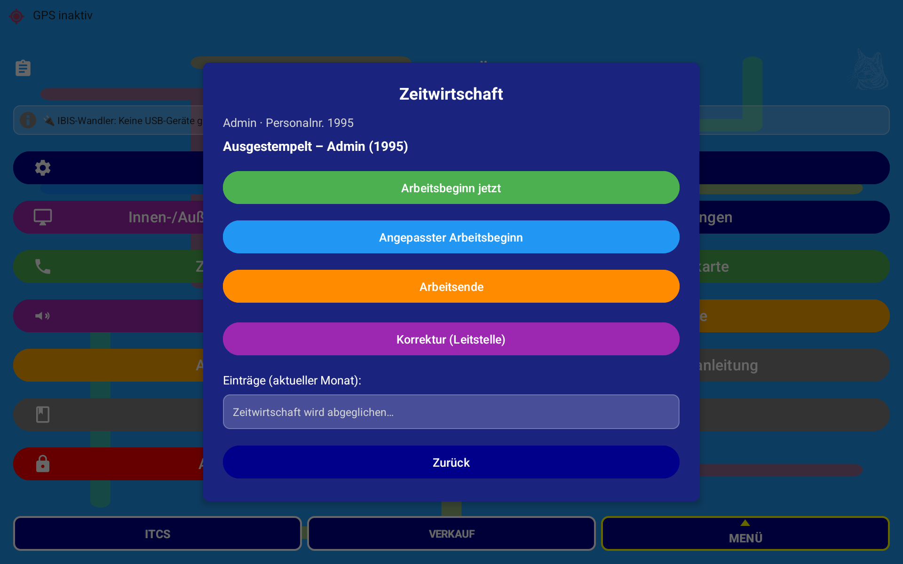

Angemeldet war **Admin**, Personalnummer **1995**, Status **ausgestempelt**. Darunter die Einträge des aktuellen Monats.

- **Arbeitsbeginn jetzt** stempelt mit der Gerätezeit ein. Das schreibt einen Arbeitstag und wurde nicht gedrückt.
- **Angepasster Arbeitsbeginn** erlaubt eine andere Beginnzeit, wenn der Dienst schon vor der Anmeldung angefangen hat.
- **Arbeitsende** stempelt aus. Eine offene Pause wird dabei geschlossen.
- **Korrektur (Leitstelle)** ist die nachträgliche Zeitkorrektur. Sie löscht den Tag nicht, sie berichtigt ihn.
- **Zurück** lässt die Stempel unverändert.

Pause aus dem Hauptmenü ist etwas anderes als diese Liste: sie sperrt sofort den Bildschirm, setzt die Pause in der Zeitwirtschaft und verlangt zum Weiterarbeiten das Anmeldekennwort. Ein bloßes Entsperren ist keine neue Anmeldung. Datumgesteuerte Hinweise erscheinen deshalb dabei nicht noch einmal.

Abmelden aus dem Menü öffnet die Anmeldung sofort. Das Arbeitsende wird im Hintergrund geschrieben, der Verkauf und die Standortdaten werden nachgesendet. Die App zu beenden schreibt kein Arbeitsende.

## 16. Mängelkarte

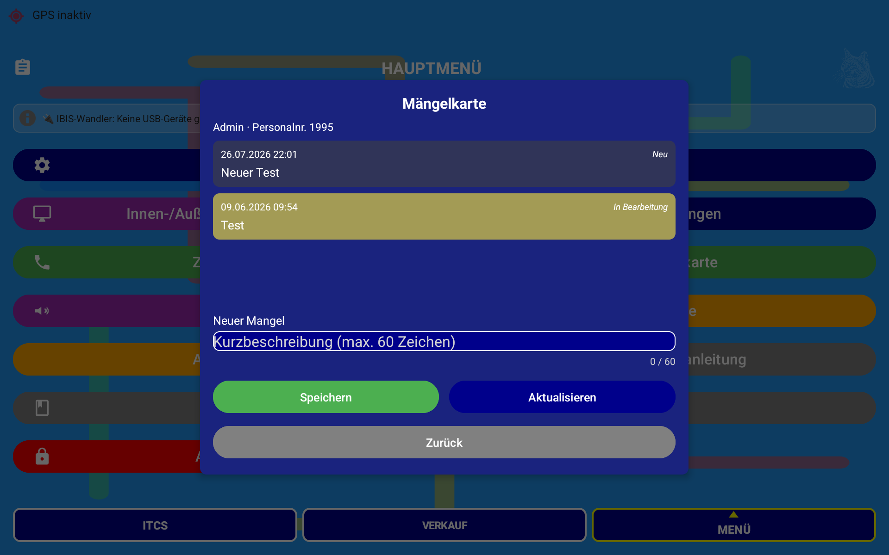

Liste der Mängel mit Datum und Status, zum Beispiel Neu oder In Bearbeitung. Unten ein Feld für einen neuen Mangel, höchstens 60 Zeichen, mit Zähler. **Speichern** legt den Mangel ab, **Aktualisieren** holt die Liste neu, **Zurück** verwirft einen angefangenen Text. Es wurde nichts gespeichert.

## 17. Ansagen

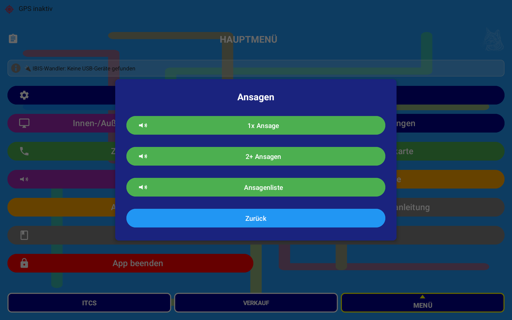

- **1x Ansage**: öffnet sofort die Dateiauswahl des Tablets und verlässt das Menü. Eine Datei antippen übernimmt sie in die App. Kommt man aus der Dateiauswahl zurück, kann das Tablet **Pause beenden** verlangen. Das ist keine neue Anmeldung.
- **2+ Ansagen**: zuerst der Dialog „Mehrere Ansagen hinzufügen“. **Abbrechen** schließt ihn, ohne eine Datei zu holen. **Hinzufügen** öffnet die Dateiauswahl für mehrere Tondateien. Hinzufügen wurde nicht gedrückt.
- **Ansagenliste**: „Ansagen verwalten“, auf diesem Gerät 912 Dateien. Oben ein Suchfeld. Jede Zeile zeigt den Dateinamen, den Schalter **Sonderansage aktiv** und, außer bei fest eingebauten Tönen, ein Löschen. Der Schalter legt fest, ob die Datei unter Sonderansagen im ITCS erscheint, und speichert sofort. Ein Tipp auf den Dateinamen spielt sie sofort. Löschen fragt vorher. Es wurde nichts abgespielt, umgeschaltet oder gelöscht. **← Zurück** führt ins Menü.
- **Zurück** im Ansagen-Fenster bleibt im Menü.

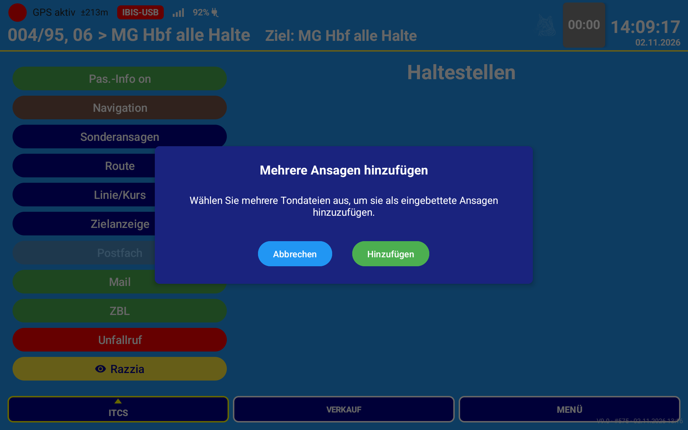

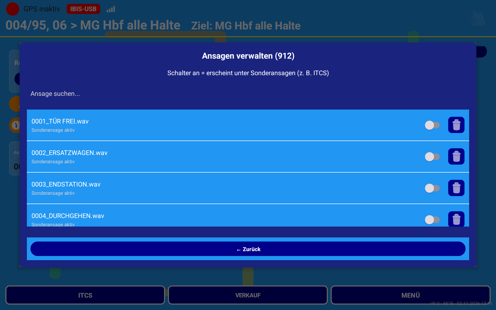

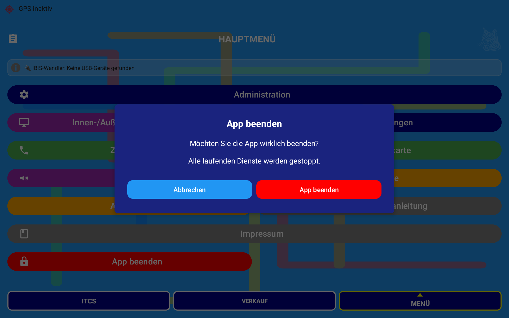

Eine neue Datei ist erst eine Sonderansage, wenn ihr Schalter an ist. Die Sonderansagen im ITCS spielen nur, was dort eingeschaltet ist.

## 18. Kurzanleitung und Impressum

Die Taste Bedienungsanleitung öffnet den Kurztext in der App. Er beschreibt den Grundgedanken: Ansagen an gespeicherten Haltestellen, von Hand oder automatisch.

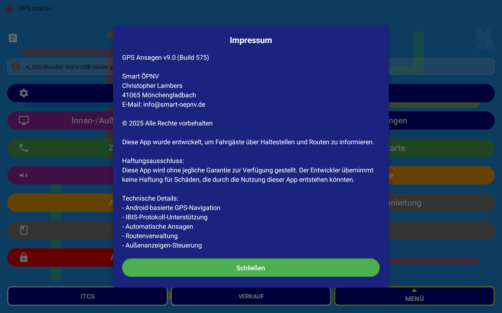

GPS Ansagen v9.0 (Build 575). Smart ÖPNV, Christopher Lambers, 41065 Mönchengladbach, info@smart-oepnv.de.

## 19. Anmeldung, Hinweise, Pause

Die Aufnahmen liefen in einer bestehenden Anmeldung. Der Ablauf davor:

1. Die App startet auf der Anmeldung, sobald niemand angemeldet ist oder jemand sich abgemeldet hat.
2. Personalnummer und Kennwort müssen zur Mitarbeiterliste passen, die aus dem Planer gekommen ist.
3. Nach einer echten Anmeldung zeigt das Gerät jeden datumgesteuerten Hinweis, der heute in den gesetzten Zeitraum fällt. Der Text erscheint so, wie er im Planer steht, inklusive Leerzeilen in der Mitte. Der Name des Hinweises ist nur die Zeile in der Planerliste und steht nicht auf dem Tablet.
4. Die Hinweise kommen kurz nach der Anmeldung aus dem bereits gespeicherten Datenstand, nicht erst beim nächsten Routenabgleich.
5. Jeder Fahrer sieht sie einmal pro Anmeldung. Entsperren nach einer Pause ist keine neue Anmeldung.
6. OK schließt den aktuellen Hinweis. Weitere gültige Hinweise folgen direkt dahinter.

Ein Hinweis ohne Text wird im Planer nicht als leere Meldung geschickt. Leere Datumsfelder gelten als heute.

## 20. Was beim Datenabgleich ankommen muss

Ohne Abgleich aus dem Planer fehlen Routen, Ansagen, Ziele, Tickets, Mitarbeiter und Hinweise. Der Abgleich darf vorhandene Mitarbeiter und Fahrzeuge nicht leeren, wenn die neue Lieferung diese Listen nicht enthält. Eine leere Liste ist dann kein Löschauftrag.

Datumgesteuerte Hinweise, Zieltexte und Ticketprodukte wirken auf dem Tablet erst nach einem Abgleich und, bei einer schon laufenden App, nach der nächsten Übernahme. Die Hinweise einer schon angemeldeten Schicht bleiben die der letzten Übernahme, bis sich jemand neu anmeldet.

## 21. Was bei den Aufnahmen unverändert blieb

- Linie 004, Kurs 95, Fahrt 06 und die Haltestellenliste.
- Schalter in den Einstellungen wie vorher: Verkauf an, Hauptgerät an, Nachtmodus aus, Richtungserkennung an. Die Testfahrt-Freigabe wurde angetippt und danach wieder ausgeschaltet. Es läuft keine Simulation.
- Razzia nach dem kurzen Umschalten wieder aus. Der Entwerter-Schalter für die Razzia-Taste wurde nicht geändert.
- Kein Fahrschein gedruckt, kein Protokoll umgestellt, kein SEV gespeichert, kein Datenabgleich gestartet, kein Mitarbeiter geändert, keine Dropbox neu verbunden.
- Keine Mailvorlage, kein Unfallruf, kein ZBL-Anruf, kein Arbeitsbeginn. Die Pause-Taste im Menü und Abmelden wurden nicht gedrückt. Zwangsabmelden wurde nicht benutzt.
- „2+ Ansagen“ mit Abbrechen geschlossen, keine Datei hinzugefügt. Die Ansagenliste nur angesehen. App beenden mit Abbrechen geschlossen.
- Das Tablet steht wieder auf dem Hauptmenü.
